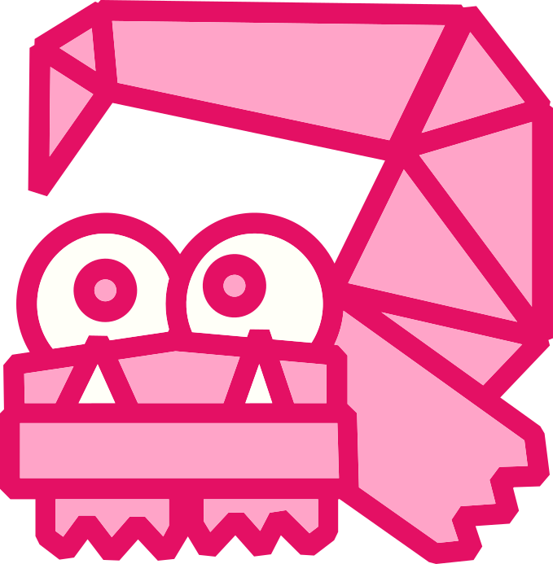

{# The studio first, then its founder. HTML only (no Markdown) so the layout
   classes stay exactly as written. #}

<header class="page-head">
  
About

  <h1>Questadon: here to help humans play.</h1>
  
Questadon is a tabletop role-playing game studio created by Sarah Brown, a 90s-brand nerd from Southern Ontario, Canada.

</header>

<section class="studio" aria-labelledby="studio-title">
  
  

    <h2 class="visually-hidden" id="studio-title">The studio</h2>
    
Because playing is good for you.

    
Questadon makes cinematic, collaborative, occasionally chaotic games for people who like to laugh, cry, argue, and make dumb decisions in make-believe scenarios. Founded in 2026 near Waterloo, Canada, Questadon is a tiny TTRPG studio with a focus on keeping humans connected through imagination and play. 

  

</section>

<section class="section founder" aria-labelledby="founder-title">
  <figure class="founder__photo">
    
  </figure>
  

    
The founder

    <h2 id="founder-title">Sarah Brown</h2>
    
Hi, I’m Sarah. I play, run, and design TTRPGs, because I like to make my friends laugh and cry. (And you and your friends, too, if you’re into that kind of thing.)

    
My first published game, <em>Final Light</em>, is a short-form horror-survival zombie RPG with a focus on intense escape, limited inventory, and personal stakes. It was funded on Kickstarter within the first minute! You can <a href="/projects/final-light-ttrpg/">find out more about Final Light</a>, including how to try it for free.

    
One of my favourite things about this community is how generous and creative folks are. I’ve learned a ton from other creators, and hope to pay it forward! If you’re making TTRPG content too—or just want to trade ideas—I’d love to hear from you.

    

      <a class="link-arrow" href="https://www.instagram.com/questadon" rel="me">Say hi on Instagram →</a>
      <a class="link-arrow" href="/#newsletter">Join the email list →</a>
    

  

</section>
